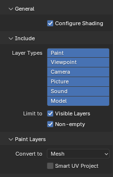

# Importing Quill files

This page details the supported features when importing Quill files into Blender using the addon.

Features are listed from the point of view of Quill.

The following key is used:
- ✅: full support
- ⚠️: partial support
- ❌: not supported

## Scene hierarchy
Quill files represent the scene as a hierarchy of layers, this hierarchy is imported as a hierarchy of Blender objects.

All layer types are converted to Blender objects with matching data
- Group layer
- Paint layer
- Camera layer
- Viewpoint layer (spawn area)
- Picture layer
- Sound layer
- Model layer

## Common properties

Properties shared by all layer types

### General properties

| Feature |Status|
| ------------- |:---:|
| Name    | ✅ |
| Visible    | ⚠️ |
| Locked    | ❌ |
| Collapsed    | ❌ |
| Transform    | ✅ |
| Pivot    | ❌ |

Visibility is imported but treated differently because Blender objects don't inherit visibility (hiding the parent doesn't hide the children).

By default hidden layers are not imported. You can force their import by unchecking Limit to > Visible layers in the import dialog. In this case hidden layer groups will be imported and forced visible.

### Key frame animation data

| Feature |Status|
| ------------- |:---:|
| Transform  key frames  | ✅ |
| Opacity key frames  | ❌ |
| Visibility key frames    | ⚠️ |
| Offset key frames  | ⚠️ |
| Looping  | ⚠️ |
| Clips  | ⚠️ |
| Key frame interpolation  | ✅ |

Base transforms and transform keys are imported and inherited between the parent group and children.

Visibility and Offset key frames are used to define "clips". They are only supported in the Mesh importer for frame by frame animation, not in the Grease Pencil or Curve importers.

How transform key frames are imported is configured under Animation > Transform Keys in the import dialog:
- **Keyframes** (default): each Quill key becomes a Blender key frame, with matching interpolation. This is the easiest to edit afterwards. When a parent sequence loops, one iteration is keyed and a Cycles F-curve modifier repeats it indefinitely, even past the end of the Blender timeline. Layers that can't be represented this way (clips or offsets on parent sequences, loops inside loops, or a loop cutting a segment in the middle of an interpolation) are baked automatically.
- **Bake**: the Quill animation is sampled on every frame of the Blender timeline, taking looping, clips and offsets of parent sequences into account. Frame holds are collapsed. Use this to play back looping or clipped animations as they appear in Quill.
- **None**: only the base transform is imported.

The scene frame rate is set to the Quill frame rate before importing, so key frames land on the right frames.

Key frame interpolation (None, Linear, Ease in, Ease out, Ease in/out) is generally supported but may not be an exact mathematical match on the intermediate frames.

## Quill paint layers

Paint layers contain one or more drawings made of paint strokes. On import the drawings are converted to Mesh, Grease pencil or Curve objects, this can be configured in the import dialog.

### Import as Mesh

The following features are supported when importing paint layers as Mesh

| Feature |Status|
| ------------- |:---:|
| Ribbon brush    | ✅ |
| Cylinder brush    | ✅ |
| Ellipse brush    | ✅ |
| Cube brush  | ✅ |
| Width  | ✅ |
| Color  | ✅ |
| Opacity  | ✅ |
| Directional opacity  | ❌ |
| Frame by frame animation  | ✅ |
| Looping  | ✅ |
| Clips  | ✅ |

#### Mesh material
Color and opacity are implemented via vertex attributes.

A single "Principled BSDF" material is created and shared by all imported meshes. This material reads the vertex colors and alpha attributes that were stored in the mesh during import.

To preview the scene with colors that match Quill as much as possible:
- In viewport shading mode "Material Preview", the colors should be pretty close but make sure the color management is set up correctly under Render > Color Management, with Display Device = `sRGB` and View Transform = `Standard` (not `AgX`). You can also go in the options and set the Render Pass to `Diffuse Color` (instead of `Combined`) to disregard some effects of the PBR material, or change the material to a Diffuse BSDF.
- Alternatively, in Viewport shading mode "Solid", go in the shading options, select Lighting = `Flat`, and Color = `Attribute`.

#### Mesh animation
When importing, the Quill timeline is remapped to the Blender frame range. Quill frames outside that range are discarded.

For the base frame by frame animation the addon creates a separate mesh object for each drawing and animate the visibility of these objects so that only one object is visible on a particular frame.

Looping of the base frame by frame animation is supported, as well as clips, both on the paint layer itself and on parent sequences. Clip offsets (left-trim) are also supported.

Looping and clips of parent sequences also apply to transform key frames, see the Transform Keys option above.

### Import as Grease Pencil

The following features are supported when importing paint layers as Grease Pencil

| Feature |Status|
| ------------- |:---:|
| Ribbon brush    | ❌ |
| Cylinder brush    | ✅ |
| Ellipse brush    | ❌ |
| Cube brush  | ❌ |
| Width  | ✅ |
| Color  | ✅ |
| Opacity  | ✅ |
| Directional opacity  | ❌ |
| Frame by frame animation  | ✅ |
| Looping  | ✅ |
| Clips  | ❌ |

All brushes are converted to the Grease Pencil line.

⚠️ Warning: if your Quill artwork uses the Ribbon brush it will look completely bloated when imported, because Grease Pencil is like a billboard always facing the viewer. It will not respect the orientation of the Ribbon, or of any other Quill brush. This is why the Cylinder brush, with its quasi-radial symmetry, is the only visually compatible brush.

#### Grease Pencil Caps type

All strokes are created with Caps type `Round`. This shouldn't really matter since Quill already adds a zero-width point at the ends of all strokes so whether it's round or square doesn't make a difference. In Blender the caps are added dynamically by the renderer, this is relevant for exporting and round-tripping (more details on the export page).

#### Grease Pencil material
Width, color and opacity are assigned to the corresponding fields in the Grease Pencil stroke: pressure, vertex color and strength, respectively.

The created strokes use the default Grease Pencil material with Line type = Line, Style = Solid.

💡 Note: to get colors that match Quill make sure the color management is set up correctly under Render > Color Management. Display Device = `sRGB`, View Transform = `Standard` and not `AgX`.

#### Grease Pencil frame by frame animation

The base animation is imported into Grease Pencil frames.

💡 The frame range in the Blender timeline is used to generate the drawings at the corresponding frames so if looping is enabled on the Quill layer it will generate the drawings over the entire Blender timeline.

Only the base animation is supported. Clips are not supported.

### Grease Pencil v2 and v3
Grease Pencil v2 (Blender 4.2 and below) and v3 (Blender 4.3 and above) are supported. If you find any anomalous behavior please report the problem.

### Import as Curve

When importing paint layers as Curve objects, the paint strokes are converted to polyline splines. Only the point positions are retained. Animation is not supported, only the first drawing is imported.

This option is mainly used to attach other objects to Quill strokes using the "Follow Path" constraint. This can be used for example to attach a Blender camera to a trajectory that was drawn in Quill.

## Quill camera layers

Quill cameras are imported as Camera objects.

| Feature |Status|
| ------------- |:---:|
| Field of view    | ✅ |

## Quill picture layers

Quill picture layers are imported as Images.

| Feature |Status|
| ------------- |:---:|
| Import image from file path    | ✅ |
| Import image from QBIN | ✅ |
| Position, orientation and scale | ✅ |
| 360° images    | ❌ |
| Viewer locked    | ❌ |

Quill file format contains both the original path the image was loaded from and the raw image data in the QBIN file. The importer uses the file path in priority. If the file is no longer available it reads the data in the QBin file.

Only type = `2D` is supported. `360 Equirectangular Mono` and `360 Equirectangular Stereo` are not supported.

## Quill sound layers

Quill sound layers are imported as Speaker objects and channels with sound strips in Blender sequencer.

| Feature |Status|
| ------------- |:---:|
| Import sound from file path    | ✅ |
| Import sound from QBIN | ✅ |
| Spatial audio | ❌ |
| Gain    | ❌ |
| Attenuation    | ❌ |
| Loop    | ❌ |
| Clips in the sound layer | ✅ |
| Clips in parent layers  | ❌ |

Quill file format contains both the original path the sound was loaded from and the raw sound data in the QBIN file. The importer uses the file path in priority. If the file is no longer available it will read the data from the QBIN file, extract it to a new .wav file in the Quill project folder, and load it from there.

A speaker object is created to match the sound layer position and animation but it is not linked with the audio file.

Clips created in the sound layer itself are recreated as sound strips in Blender video sequencer so the sound should start and stop at the correct times and with the correct offset. Looping is not supported as it doesn't seem to be supported in Blender strips.

In Quill making a sound layer invisible does not mute the sound so sound layers are always loaded even if the option to include hidden layers is unchecked. To mute the sound you can mute it from the video sequencer. However, if the sound layer is inside a hidden group it will not be loaded as the group will be excluded.

## Quill model layers

Quill model layers are imported as Mesh objects.

| Feature |Status|
| ------------- |:---:|
| OBJ    | ✅ |
| FBX | ✅ |
| Multi-layer FBX | ✅ |
| Import scale    | ✅ |
| Shading model    | ❌ |
| Render wireframe    | ❌ |

Quill file format contains both the original path the model was loaded from and the raw mesh data in the QBIN file. The importer only uses the file path. If the file is no longer available it will replace the layer with an EMPTY object.

For multi-mesh FBX files the mapping between the layers and the meshes is done by name, meaning you should not rename the layers of the sub-meshes. Deleting a sub-mesh layer is supported.

Animation of sub-mesh layers is supported. 

Shading model and Render wireframe are render-time properties in Quill and are ignored by the importer.

For the import scale in Quill import dialog (meters, centimeter, etc.), Quill bakes it in the transform of the top-level group, so it is automatically imported by the add-on.

## Import dialog

### General

**Configure Shading**

Whether to configure the shading options in the Blender 3D viewport to match Quill as much as possible.

### Include

**Layer Types**

Select which layer types to import. Unchecked layer types are not imported at all.

**Limit to**

Visible layers: only import layers that are visible in Quill. Hidden layers are not imported at all.

Non empty: only create Blender objects for group layers that contain content, this is evaluated after the layer type and visible filters are applied.

### Paint layers

**Convert to**

Behavior when importing paint layers
- Mesh
- Grease Pencil
- Curve

**Smart UV Project**

Run Blender Smart UV Project on meshes to generate UVs.

